<div align="center">

# Industrial Safety Workflow

### Rule-driven industrial safety monitoring, incident management & corrective-action tracking

A full-stack OT safety workflow demonstration built with **React 18, FastAPI, PostgreSQL 16 and Docker Compose**.

<p>
  
  
  
  
  
</p>

**Monitor · Detect · Investigate · Verify · Resolve**

[Features](#-key-capabilities) · [Screenshots](#-application-preview) · [Architecture](#-system-architecture) · [Setup](#-run-locally) · [Data](#-synthetic-data--validation)

</div>

---

## Project overview

Industrial Safety Workflow brings plant topology, machine and interlock state histories, alarm events, operator acknowledgements, safety incidents, and corrective actions into one workspace.

The application uses deterministic business rules and SQL-based analytics to prioritize critical hazards, correlate alarms with machine states, track acknowledgement SLAs, identify recurring alarm patterns, and preserve incident history.

> **Scope:** This is a local project demonstration evaluated with deterministic synthetic data. It is not connected to live PLC/SCADA equipment and is not certified industrial-safety software.

## The problem

Safety operations require engineers and operators to correlate machine telemetry with alarm definitions, acknowledgement deadlines, incident evidence, and maintenance follow-through. When those records are separated, teams can struggle to:

- Identify critical hazards among repeated or nuisance alarms.
- Connect an alarm to a recent fault or bypassed interlock state.
- Track acknowledgement timing and SLA exceptions.
- Preserve evidence and a reliable incident lifecycle history.
- Enforce verification before corrective actions and incidents are closed.
- Identify recurring alarm patterns that may need preventive maintenance.

## ✨ Key capabilities

| Capability | What the application does |
|---|---|
| Plant & equipment topology | Manages plants, machines, safety zones, interlocks, alarm definitions, and operator shifts. |
| Machine-state ingestion | Validates and stores append-only machine/interlock state history. |
| Alarm ingestion | Validates alarm events and uses immutable source IDs for idempotency. |
| Automatic incident correlation | Creates an incident for a `HIGH` or `CRITICAL` alarm when the same machine had a `FAULT` or `BYPASSED` interlock state in the previous five minutes. |
| Acknowledgement SLA | Records operator acknowledgements and evaluates response time against the stored alarm definition. |
| Incident evidence & history | Associates evidence and lifecycle transitions with incidents. |
| Corrective-action verification | Requires completion and successful verification before an action can close. |
| Incident closure controls | Blocks incident resolution/closure until all linked corrective actions are verified and closed. |
| Alarm analytics | Detects clusters of at least three matching alarms on one machine with consecutive gaps of no more than 60 seconds. |
| Reproducible data | Generates deterministic synthetic records, validation reports, checksums, and a source manifest. |

## 🖥️ Application preview

### Safety overview

<p align="center">
  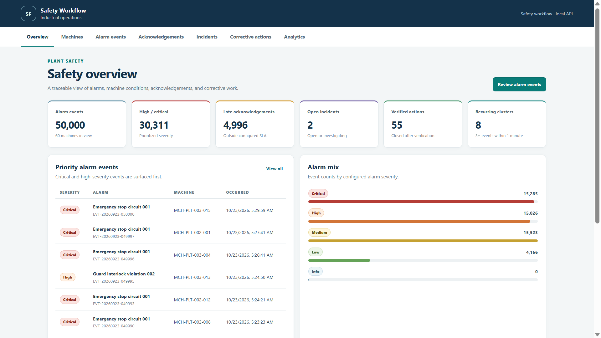
</p>

### Operational views

<table>
  <tr>
    <td width="50%">
      <p align="center"><strong>Machine register</strong></p>
      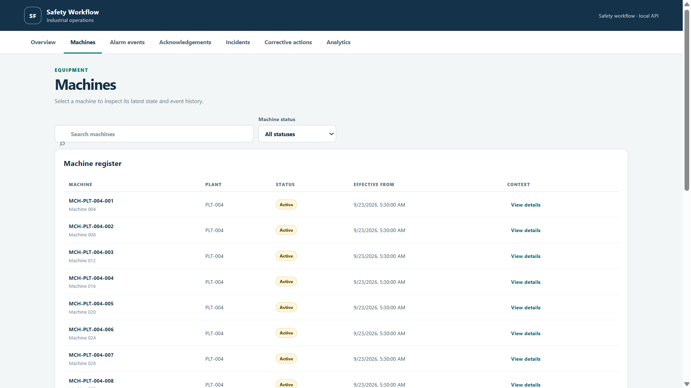
    </td>
    <td width="50%">
      <p align="center"><strong>Alarm events</strong></p>
      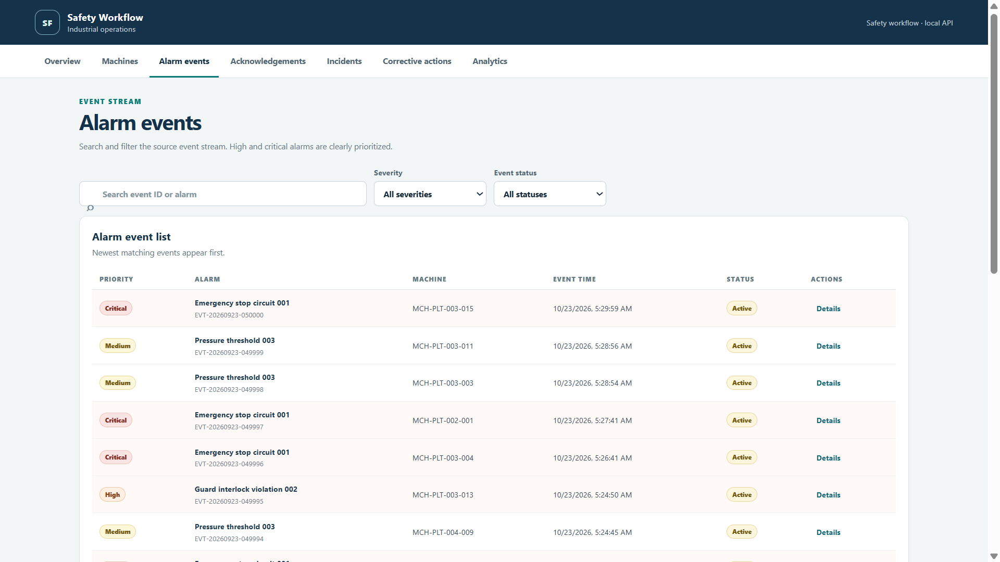
    </td>
  </tr>
  <tr>
    <td width="50%">
      <p align="center"><strong>Acknowledgements</strong></p>
      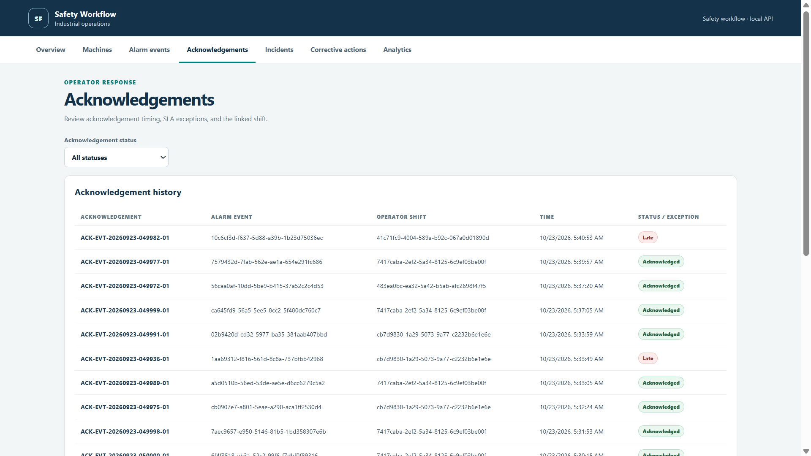
    </td>
    <td width="50%">
      <p align="center"><strong>Incident management</strong></p>
      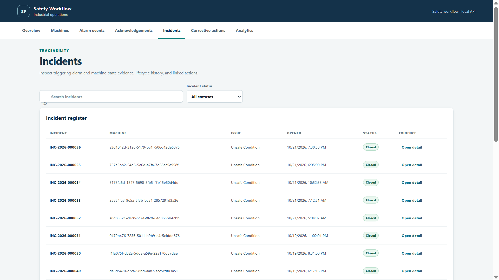
    </td>
  </tr>
  <tr>
    <td width="50%">
      <p align="center"><strong>Corrective actions</strong></p>
      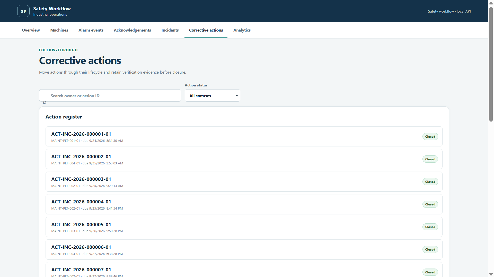
    </td>
    <td width="50%">
      <p align="center"><strong>Analytics</strong></p>
      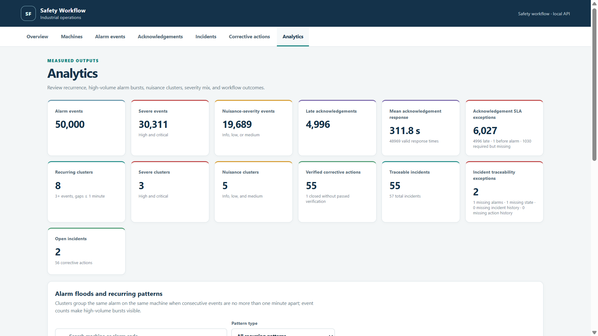
    </td>
  </tr>
</table>

## 🏗️ System architecture

The React application sends relative `/api/` requests through the frontend proxy to FastAPI. The backend applies validation and workflow rules, then uses SQLAlchemy/database access to read and write PostgreSQL. Docker Compose runs the local services.

<p align="center">
  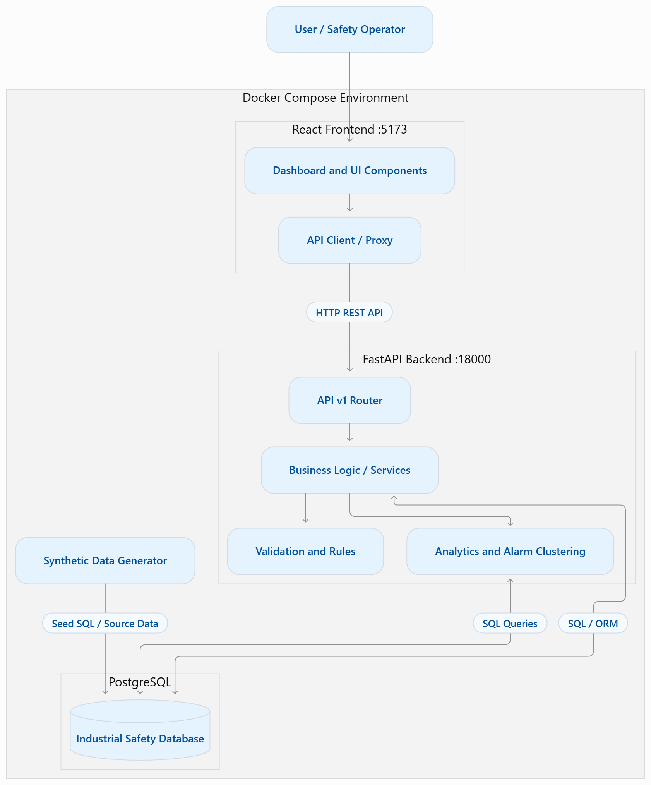
</p>

### Request and database path

1. A user interacts with the React interface.
2. The frontend API client sends an HTTP request to `/api/v1/...`.
3. The frontend server proxies the request to FastAPI.
4. FastAPI routes the request to a workflow or analytics service.
5. The service validates input and applies domain rules.
6. SQLAlchemy executes database operations against PostgreSQL.
7. FastAPI returns a JSON response to React.

<p align="center">
  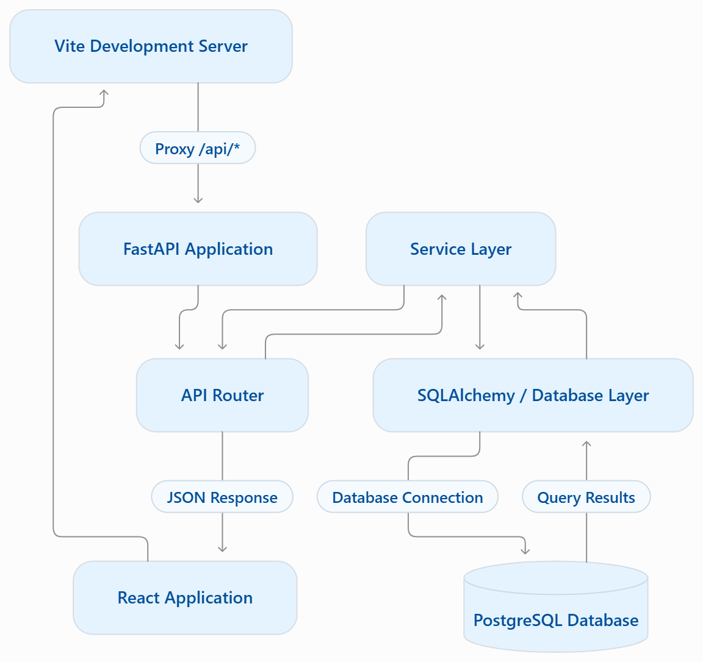
</p>

## 🔄 Safety event workflow

Machine-state and alarm events enter through the API. The service validates the events, checks immutable source IDs to prevent duplicate ingestion, and evaluates alarm severity against recent machine-state history.

<p align="center">
  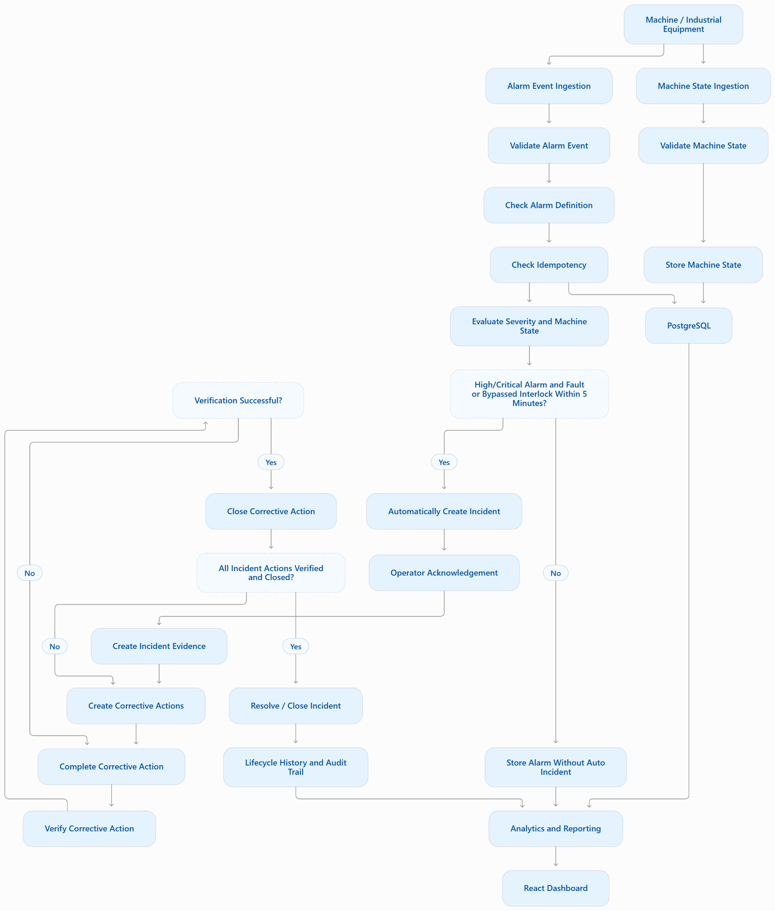
</p>

### Core business rules

| Rule | Behavior |
|---|---|
| Idempotent ingestion | Repeated deliveries with the same immutable source ID do not create duplicate source records. |
| Incident trigger | A `HIGH`/`CRITICAL` alarm needs a same-machine `FAULT` or `BYPASSED` state in the preceding five minutes to trigger automatic incident creation. |
| Acknowledgement SLA | Severity and acknowledgement SLA are evaluated using the stored alarm definition. |
| Action closure | A corrective action must be completed and successfully verified before closure. |
| Incident closure | Every linked corrective action must be verified and closed before incident resolution/closure. |
| Alarm cluster | At least three matching alarms on the same machine, with consecutive gaps of no more than 60 seconds, form a cluster. |

## 🗄️ Database design

The relational model covers plant and machine master data, alarm definitions, machine-state history, alarm events, incidents, incident evidence, corrective actions, action verification, and lifecycle history.

<p align="center">
  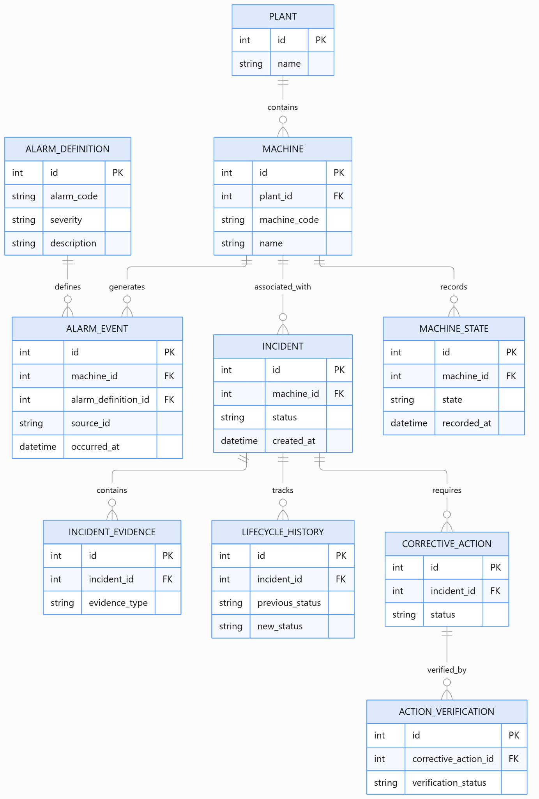
</p>

The ER diagram is a documentation-level view. The Alembic migrations and `docs/data-dictionary.md` are the authoritative sources for exact table names, columns, types, constraints, indexes, and foreign keys.

## 🧪 Synthetic data & validation

The deterministic generator uses seed **`20261022`** and creates a repeatable 30-day dataset.

| Entity | Default records |
|---|---:|
| Plants | 4 |
| Machines | 60 |
| Alarm definitions | 200 |
| Alarm events | 50,000 |

<p align="center">
  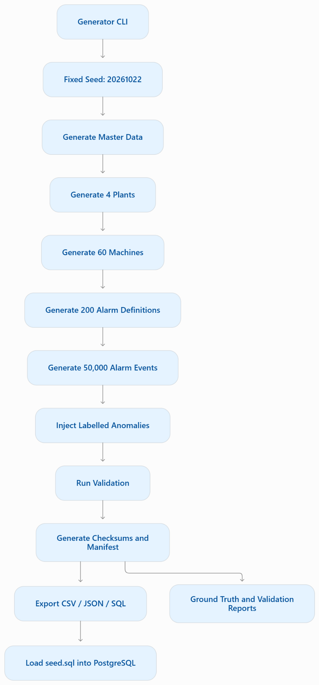
</p>

The documented labelled anomaly scenarios are:

- `acknowledgement_before_alarm`
- `impossible_interlock_state`
- `incident_without_triggering_context`
- `replay_duplicated_alarm_flood`
- `action_closed_without_verification`

The checked-in generation manifest reports all five labelled scenarios detected and matched (`F1 = 1.0`) by the validator, with zero unlabelled overlaps across the 30 input tables and `seed.sql`. These are synthetic validation results, not evidence of real-world detection performance.

Ground-truth labels and raw replay-delivery payloads remain separate from application seed data.

## 🧰 Technology stack

| Layer | Technology | Purpose |
|---|---|---|
| Frontend | React 18 | Responsive safety operations UI |
| Frontend server | Vite / configured frontend container | Local serving and `/api/` proxy |
| Backend | Python 3.12, FastAPI | Versioned REST API |
| Business logic | Python service modules | Ingestion, correlation, SLA, and lifecycle rules |
| ORM & migrations | SQLAlchemy, Alembic | Database access and schema evolution |
| Database | PostgreSQL 16 | Relational persistence and SQL analytics |
| Runtime | Docker Compose | Local multi-container environment |
| Tests | Pytest and frontend test runner | Backend/API/schema and frontend component tests |

## 🚀 Run locally

### Prerequisites

- Docker Desktop
- Docker Compose
- Git

A host Python virtual environment is not required; the application runs through Docker Compose.

### 1. Clone the repository

```bash
git clone <your-repository-url>
cd <your-project-directory>
```

### 2. Configure environment (optional)

```bash
cp .env.example .env
```

The Compose defaults work without a `.env` file. If a host port is already in use, change `API_PORT` or `FRONTEND_PORT` in `.env`.

### 3. Start the services

```bash
docker compose up --build
```

### Local endpoints

| Service | URL |
|---|---|
| React frontend | [http://localhost:5173](http://localhost:5173) |
| Frontend health | [http://localhost:5173/health](http://localhost:5173/health) |
| FastAPI health (includes PostgreSQL check) | [http://localhost:18000/health](http://localhost:18000/health) |
| OpenAPI / Swagger UI | [http://localhost:18000/docs](http://localhost:18000/docs) |

PostgreSQL readiness is checked by Compose with `pg_isready`.

## 🧱 Database migrations & tests

Apply migrations to the local application database:

```bash
docker compose exec backend alembic upgrade head
```

**Use a separate empty database for tests.** Do not run the test suite against the populated application database.

```bash
docker compose exec db sh -c \
  'createdb -U "$POSTGRES_USER" industrial_safety_test'

docker compose exec backend sh -c \
  'DATABASE_URL="${DATABASE_URL%/*}/industrial_safety_test" alembic upgrade head && \
   DATABASE_URL="${DATABASE_URL%/*}/industrial_safety_test" pytest'
```

Run frontend tests and a production build from `frontend/`:

```bash
npm ci
npm test
npm run build
```

## 📦 Generate and load synthetic data

Run the default generator from the backend container:

```bash
docker compose exec backend python -m app.generation.cli
```

Exports are written to `data/exports/` on the host. They include CSV, JSON, PostgreSQL seed SQL, ground truth, source manifest, checksums, and machine-readable and human-readable validation reports.

### Load into an empty local database

```bash
docker compose exec backend alembic upgrade head

docker compose exec backend \
  python -m app.generation.cli --output /data/exports

docker compose exec db sh -c \
  'psql -v ON_ERROR_STOP=1 -U "$POSTGRES_USER" -d "$POSTGRES_DB" -f /data/exports/seed.sql'

docker compose exec db sh -c \
  'psql -U "$POSTGRES_USER" -d "$POSTGRES_DB" -Atc "SELECT count(*) FROM alarm_event"'
```

The final command should report `50000`.

Loading is intended for an empty database. The seed process does not truncate or replace existing records. The database container sees the export directory read-only. Ground-truth and replay-delivery files are not inserted into application source tables.

### Smaller deterministic smoke run

```bash
docker compose exec backend python -m app.generation.cli \
  --plant-count 1 \
  --machine-count 3 \
  --alarm-definition-count 9 \
  --alarm-event-count 40 \
  --days 2
```

## ⚡ Performance validation

The full default dataset was loaded locally: 4 plants, 60 machines, 200 alarm definitions, and 50,000 alarm events.

These are warm, single-client local Docker Compose measurements, not production-capacity or concurrency guarantees.

| Request | Median latency |
|---|---:|
| Alarm-event page (50 rows) | 9.9 ms |
| Critical alarm page (50 rows) | 13.1 ms |
| Machine-state page (50 rows) | 5.8 ms |
| Incident page (50 rows) | 7.3 ms |
| Incident evidence | 7.6 ms |
| Analytics summary | 163.1 ms |
| Alarm-cluster page (50 rows) | 66.0 ms |

The analytics summary median was observed to decrease from 457.5 ms to 163.1 ms, and the cluster-page median from 191.4 ms to 66.0 ms. Baseline timings used three requests and final timings used five, so the comparisons are indicative rather than controlled benchmarks.

The PostgreSQL cluster-window query changed from an external sort spilling 3,240 KB to an index-only scan with no heap fetches or disk spill. Re-measure under representative concurrent load and target hardware before setting operational latency objectives.

## 📁 Project structure

```text
.
├── backend/
│   ├── app/
│   │   └── generation/
│   ├── alembic/
│   └── tests/
├── frontend/
│   ├── src/
│   └── tests/
├── docs/
│   ├── data-dictionary.md
│   └── images/
├── data/
│   └── exports/
├── docker-compose.yml
├── .env.example
├── .gitignore
└── README.md
```

## 🛡️ Scope, limitations & next steps

- Data is synthetic; no live industrial controller or plant telemetry integration is included.
- The five-minute correlation and 60-second cluster rules are deterministic demonstration rules and should be calibrated with domain experts before operational use.
- Local latency measurements do not replace load, resilience, security, or safety validation.
- A production deployment would require authentication and role-based authorization, secure secrets management, transport encryption, observability, backup/recovery, deployment hardening, and OT network/security review.
- The ER diagram is conceptual; migrations and the data dictionary are the schema source of truth.

## Stop the application

```bash
docker compose ps
curl --fail http://localhost:5173/
curl --fail http://localhost:5173/health
curl --fail http://localhost:18000/health

docker compose exec db sh -c \
  'pg_isready -U "$POSTGRES_USER" -d "$POSTGRES_DB"'

docker compose down
```

`docker compose down` removes containers but preserves the PostgreSQL volume. Add `-v` only when you intentionally want to delete local database data.

---

<div align="center">

**Industrial Safety Workflow**  
*React · FastAPI · PostgreSQL · Docker Compose*

</div>
